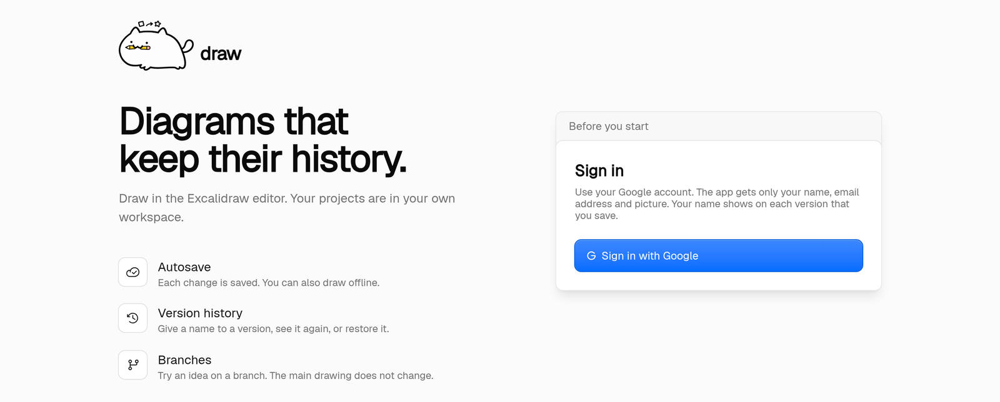
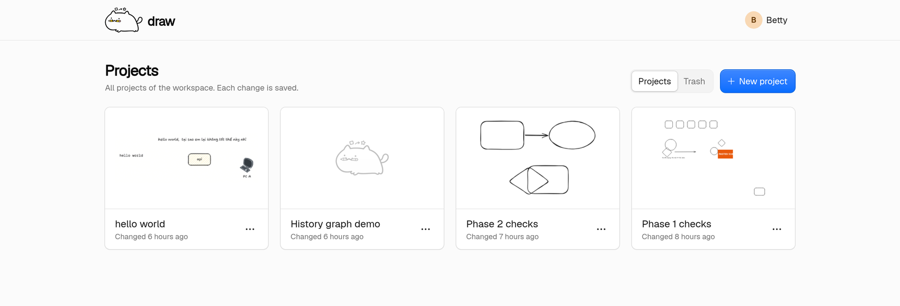
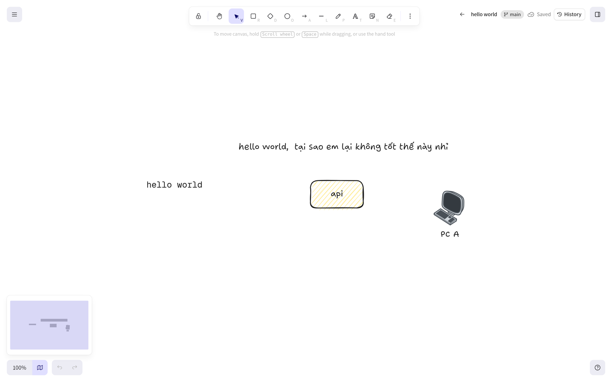
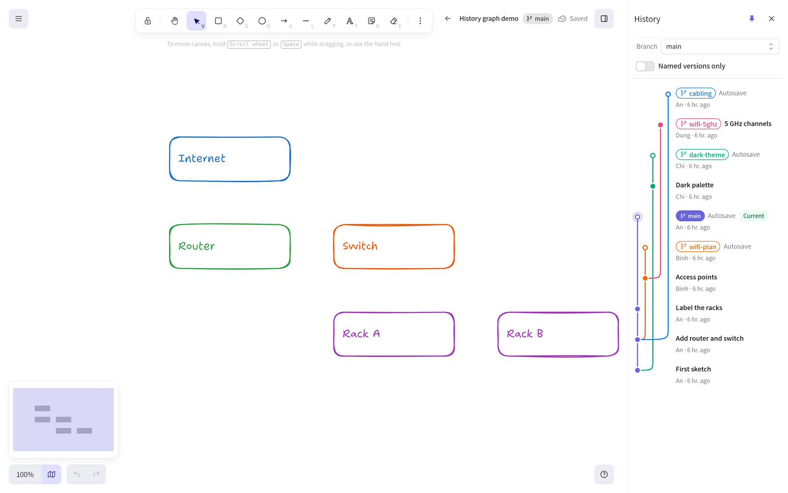
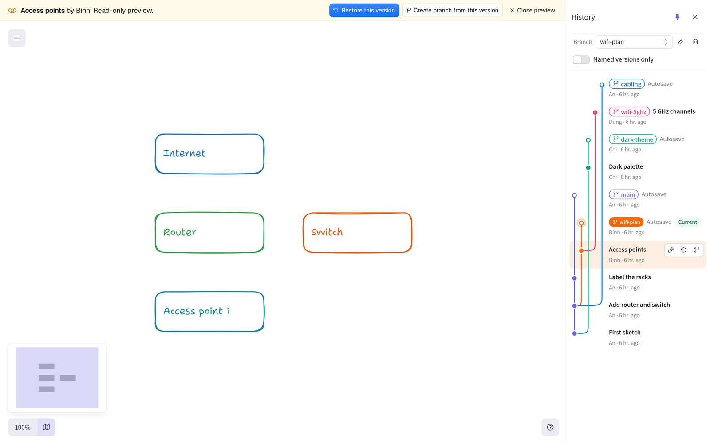
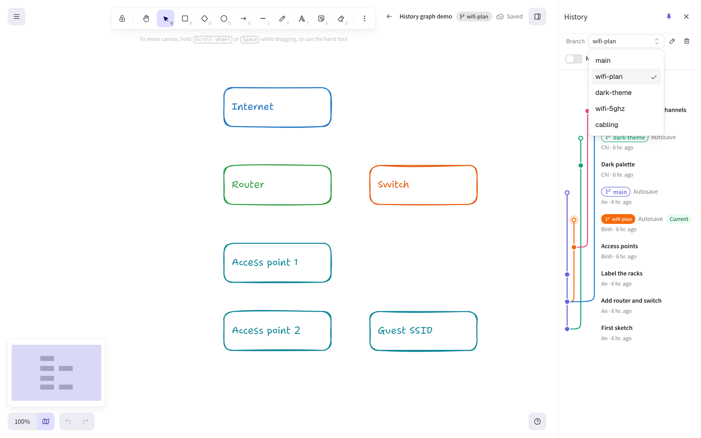
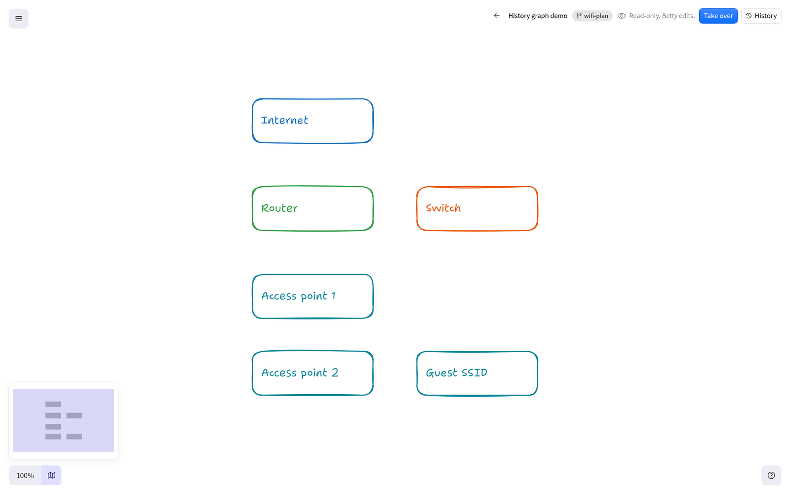

  

<h1 align="center">draw</h1>

  Diagrams that keep their history. 
  An Excalidraw editor with a project list, autosave, a version history with named versions, and branches.

  <a href="https://draw.huynhduongsh1.workers.dev"><b>Open the app</b></a> ·
  <a href="docs/architecture.md">Architecture</a> ·
  <a href="docs/deploy.md">Deploy</a> ·
  <a href="docs/sequences.md">Sequence diagrams</a> ·
  <a href="docs/plan.md">Plan</a>

The app runs on the Cloudflare free plan: one Worker, one Durable Object with SQLite for each project, and one D1 database. Each person signs in with Google and has their own workspace. The Google name is the author of each version.

## Features

### First page

Sign in with your Google account. The app gets only your name, email address and picture.

### Project list

Create, rename, move to trash and restore projects. Only you see your projects. Each card shows a thumbnail of the `main` branch.

### Editor and autosave

The pinned Excalidraw build with the minimap, 13 default libraries, and three fonts with all Vietnamese letters: DFVN Excalifont (hand-drawn), Geist (normal) and Geist Mono (code). Each change goes to IndexedDB at once and to the server 2 seconds after the last change. You can draw offline. The changes are sent when the connection is back.

### History graph

The History sidebar shows the versions of all branches as a git graph. Each branch has a colored lane. A filled dot is a named version, and a ring is the current version. `Ctrl+S` gives a name to the current version. Versions with no name are deleted after 30 days.

### Preview and restore

A click on a version shows it read-only over the canvas. "Restore this version" adds a new version with the old drawing. No version is removed.

### Branches

Create a branch from a version to try an idea. The `main` drawing does not change. Switch, rename and delete branches from the History sidebar.

### One editor for each branch

The first person who opens a branch edits it. Other persons see it read-only, with each save in about 2 seconds, and a "Take over" button.

## Documentation

| Document                                     | Content                                                                                                                                                         |
| -------------------------------------------- | --------------------------------------------------------------------------------------------------------------------------------------------------------------- |
| [docs/architecture.md](docs/architecture.md) | Packages, web app, Worker routes, D1, the `ProjectRepo` Durable Object with SQLite and WebSocket, edit lock, versions, branches, images, autosave and IndexedDB |
| [docs/deploy.md](docs/deploy.md)             | Cloudflare resources, `wrangler.jsonc`, bindings, secrets, regions, how to deploy, free plan limits                                                             |
| [docs/sequences.md](docs/sequences.md)       | Mermaid sequence diagrams of the main flows: open a project, autosave, offline and reconnect, Take over, restore, branches, old-version cleanup                 |
| [docs/plan.md](docs/plan.md)                 | The plan, the decisions and the measured results of each phase                                                                                                  |

## Commands

Install [Vite+](https://viteplus.dev/guide) (`vp`), then run `vp install`.

| Task                                     | Command                                                                    |
| ---------------------------------------- | -------------------------------------------------------------------------- |
| Local app with Worker and Durable Object | `vp -C apps/web dev`                                                       |
| Format, lint, type check                 | `vp check`                                                                 |
| Tests                                    | `vp test`                                                                  |
| Build                                    | `vp -C apps/web build`                                                     |
| Deploy                                   | `vp run deploy` (needs `CLOUDFLARE_API_TOKEN` and `CLOUDFLARE_ACCOUNT_ID`) |

## Credits

The app is built on the work of these projects. Thank you.

| Project                                                                                                                                                                                 | Use                                                                                                                                                                                                           | License           |
| --------------------------------------------------------------------------------------------------------------------------------------------------------------------------------------- | ------------------------------------------------------------------------------------------------------------------------------------------------------------------------------------------------------------- | ----------------- |
| [Excalidraw](https://github.com/excalidraw/excalidraw)                                                                                                                                  | The editor (`@excalidraw/excalidraw` build `0.18.0-3a317b5`, with the minimap)                                                                                                                                | MIT               |
| [Excalidraw libraries](https://libraries.excalidraw.com)                                                                                                                                | The 13 default libraries in `apps/web/public/libraries`, by dwelle, samu, dday987, jgodoy, fibreninja, rohanp, youritjang, pratheeshpm, anna-pastushko, mateuszbaransanok, niknm, drwnio and dmitry-burnyshev | MIT               |
| [Cloudflare Kumo](https://github.com/cloudflare/kumo)                                                                                                                                   | UI components outside the canvas                                                                                                                                                                              | MIT               |
| DFVN Excalifont: Excalifont by Excalidraw, Vietnamese by Dafont.vn                                                                                                                      | The hand-drawn font                                                                                                                                                                                           | OFL 1.1           |
| [Geist and Geist Mono](https://github.com/vercel/geist-font) by Vercel                                                                                                                  | The normal and code fonts                                                                                                                                                                                     | OFL 1.1           |
| [Phosphor Icons](https://phosphoricons.com)                                                                                                                                             | Icons (`@phosphor-icons/react`)                                                                                                                                                                               | MIT               |
| [React](https://react.dev)                                                                                                                                                              | UI library                                                                                                                                                                                                    | MIT               |
| [Tailwind CSS](https://tailwindcss.com)                                                                                                                                                 | Styles for the Kumo components                                                                                                                                                                                | MIT               |
| [Hono](https://hono.dev)                                                                                                                                                                | API routes in the Worker                                                                                                                                                                                      | MIT               |
| [idb-keyval](https://github.com/jakearchibald/idb-keyval)                                                                                                                               | IndexedDB storage for the local copy and the library                                                                                                                                                          | Apache 2.0        |
| [Cloudflare Workers](https://developers.cloudflare.com/workers/), [Durable Objects](https://developers.cloudflare.com/durable-objects/) and [D1](https://developers.cloudflare.com/d1/) | Hosting, storage and WebSockets                                                                                                                                                                               |                   |
| [Wrangler](https://github.com/cloudflare/workers-sdk) and the [Cloudflare Vite plugin](https://developers.cloudflare.com/workers/vite-plugin/)                                          | Local runtime, tests and deploy                                                                                                                                                                               | MIT or Apache 2.0 |
| [Vite+](https://viteplus.dev)                                                                                                                                                           | Toolchain: dev server, build, lint, format, tests                                                                                                                                                             | MIT               |

The cat mascot, the app icon and the favicon are made for this project. The master files are in [docs/design](docs/design).
