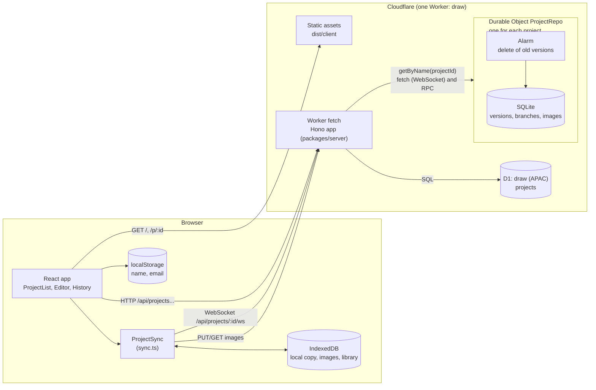
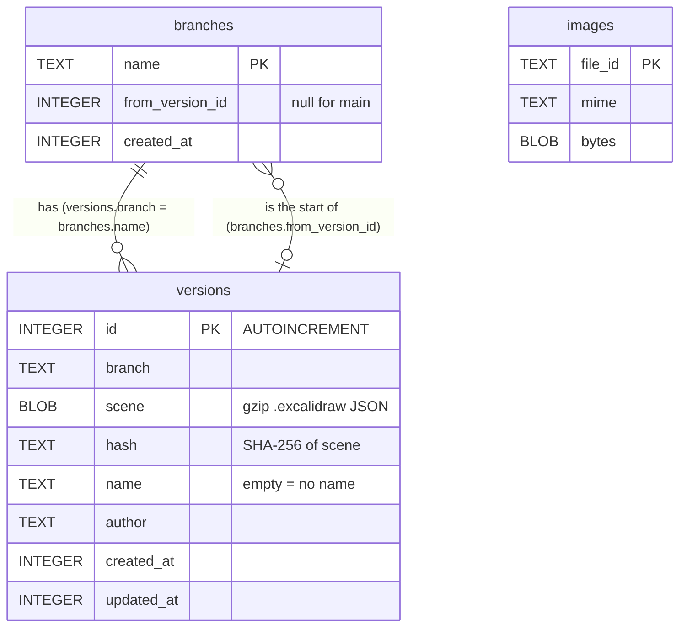

# System architecture

This document tells how the draw app works. It is based on the code on `main`. The sequence diagrams of the main flows are in [sequences.md](sequences.md). The Cloudflare resources and the deploy steps are in [deploy.md](deploy.md). The history of the decisions is in [plan.md](plan.md).

## Overview

The app is an Excalidraw editor with a project list, autosave, a version history with named versions, and branches. There is no login. All persons who have the URL see all projects, and each person types a display name one time.

One Cloudflare Worker serves the React app and the API.

- Static files (the React app, fonts, libraries, icons) come from Workers static assets.
- `/api/*` goes to the Worker code first. The Worker uses [Hono](https://hono.dev) for the routes.
- Each project has one Durable Object, `ProjectRepo`, with SQLite storage. It holds the versions, the branches and the images of the project. It is the source of truth for the drawing.
- One D1 database holds the project list (name, thumbnail, times, trash).
- The editor has one WebSocket to the Durable Object of the open project. Saves, scenes, the edit lock and change notices go through it. All other calls use HTTP.
- The browser keeps a local copy of each branch in IndexedDB, so no change is lost when the tab closes or the network stops.



## Packages

The repository is a pnpm workspace with [Vite+](https://viteplus.dev) (`vp`) as the toolchain. The package scope is `@draw`.

| Package | Path | Content |
| --- | --- | --- |
| `@draw/web` | `apps/web` | The deployed unit: the React app in `src/`, the files in `public/`, the Worker entry `worker/index.ts`, `vite.config.ts` (React, Tailwind and Cloudflare plugins) and `wrangler.jsonc`. The tests in `tests/` start the real Worker. |
| `@draw/server` | `packages/server` | The Hono routes and the D1 code (`src/index.ts`), and the `ProjectRepo` Durable Object (`src/project-repo.ts`). `test/worker.ts` is the production Worker with a clock that the tests can move. |
| `@draw/shared` | `packages/shared` | Code that the browser and the Worker both use: the API and WebSocket types and paths (`protocol.ts`), the binary frame format, gzip and SHA-256 (`scene-hash.ts`), and the version rules (`version-rules.ts`). |

`apps/web/worker/index.ts` has one line. It exports the default handler and the `ProjectRepo` class from `@draw/server`, so the Worker and each Durable Object run the same code.

## Web app (`apps/web/src`)

The app has two pages and no router library. `App.tsx` reads `location.pathname` and the `popstate` event.

| Path | Page |
| --- | --- |
| any path, when the browser has no display name | `WelcomePage` (`Profile.tsx`). It asks for a display name and an optional email. Both stay in `localStorage` (`draw.author`, `draw.email`). The server never gets the email. |
| `/` | `ProjectList.tsx`: the project cards with thumbnails, the Projects and Trash tabs, New project, Rename, Move to trash and Restore. |
| `/p/<id>` and `/p/<id>?branch=<name>` | `Editor.tsx`, loaded with `React.lazy` because it is large. `main` has no `branch` parameter. A switch of branch opens a new editor. |

The UI outside the canvas uses [Cloudflare Kumo](https://github.com/cloudflare/kumo) components, styled with Tailwind CSS v4. Inside `.excalidraw` the Tailwind reset is reverted, so Excalidraw keeps its own styles. Parts that have the `kumo-scope` class (the status bar and the preview bar) use the Kumo styles. The icons are [Phosphor](https://phosphoricons.com) icons.

Other files:

| File | Task |
| --- | --- |
| `sync.ts` | `ProjectSync`: autosave, the local copy, the WebSocket, the edit lock, restore. See [Autosave and sync](#autosave-and-sync). |
| `api.ts` | The HTTP calls, the editor path, and the name and email in `localStorage`. |
| `History.tsx` | The History sidebar: branch selector, "Named versions only" switch, the version graph, and the read-only `VersionPreview`. |
| `graph.ts` | `layoutGraph`: puts the versions of all branches into lanes like a git graph. |
| `images.ts` | Loads an image from IndexedDB or from the server. |
| `fonts.ts` | Replaces three Excalidraw fonts before the editor starts. |
| `libraries.ts` | Loads the 13 default `.excalidrawlib` files the first time, and keeps the library in IndexedDB. |
| `TextDialog.tsx` | The Kumo dialog for names and confirms. |

### Editor

The editor uses the pinned Excalidraw build `0.18.0-3a317b5`, because only that build has the minimap. Its API is different from the 0.18.1 documentation (for example `onExcalidrawAPI` and `exportScene`).

- **Fonts.** `fonts.ts` replaces the registry entries of three Excalidraw text styles: "Hand-drawn" (`Excalifont`) uses Shantell Sans, "Normal" (`Nunito`) uses Geist, and "Code" (`Comic Shanns`) uses Geist Mono. The three files are in `public/fonts`, and they have all Vietnamese letters. The app loads them before the editor measures text. The scene keeps the Excalidraw font numbers.
- **Change detection.** `onChange` compares `hashElementsVersion(elements)`, the background color and the number of files with the last value. Only a change of the scene calls `sync.changed()`. A change of the selection or the view does not.
- **Deleted elements.** The editor saves `getSceneElementsIncludingDeleted()`, so a merge of two copies does not bring a deleted element back.
- **Status bar.** It shows "Connecting", "Saving", "Saved", "Offline, saved in this browser", or "Read-only. *Name* edits." with a "Take over" button.
- **Thumbnail.** After a save on `main`, the editor makes a PNG of at most 320 px with `exportScene`, at most each 10 seconds, and sends it with `PATCH /api/projects/:id`.
- **`Ctrl+S`** gives a name to the current version. The main menu item "Save to..." still saves a `.excalidraw` file.

### History panel

The History panel is an Excalidraw `Sidebar`. It loads `GET /branches` and `GET /versions?all=1` (100 versions, and "Show more" adds 100). It reloads when the server sends a `history` or `branches` notice.

`layoutGraph` gives each branch one lane, from its newest version in the list down to the version that it was created from. A lane is used again below the place where its branch starts. The color of a branch is its place in the branch list, so it does not change with the filter. A filled dot is a named version, and a ring is the current version.

A click on a row opens a read-only preview: a second Excalidraw instance over the canvas, with "Restore this version", "Create branch from this version" and "Close preview". Restore is possible only for a version of the open branch, and only for the editor of the branch.

## Worker (`packages/server/src/index.ts`)

The Worker is a Hono app. `wrangler.jsonc` sets `run_worker_first: ["/api/*"]`, so other paths are static files, and an unknown path returns `index.html` (`single-page-application`).

| Method and path | Goes to | Task |
| --- | --- | --- |
| `GET /api/health` | D1 | Returns `{ ok, colo }`. |
| `GET /api/projects?trash=1` | D1 | The projects, or the projects in the trash, newest change first. |
| `POST /api/projects` | D1 | Creates a project with a random UUID. |
| `GET /api/projects/:id` | D1 | One project. |
| `PATCH /api/projects/:id` | D1 | Changes `name`, `trashed` or `thumb`. A new thumbnail also sets `updated_at`, so the project moves to the top. |
| `GET /api/projects/:id/ws` | Durable Object `fetch` | The WebSocket upgrade. Other requests get 426. |
| `PUT /api/projects/:id/images/:fileId` | `putImage` RPC | Stores an image of at most 1.5 MB (413 if larger). |
| `GET /api/projects/:id/images/:fileId` | `getImage` RPC | Returns the image with `Cache-Control: immutable`, because the file id comes from the content. |
| `GET /api/projects/:id/versions?branch=&all=1&named=1&limit=` | `listVersions` RPC | The versions, newest first, at most 500. |
| `GET /api/projects/:id/versions/:versionId/scene` | `getVersionScene` RPC | The gzip scene of a version, for the preview. |
| `PATCH /api/projects/:id/versions/:versionId` | `nameVersion` RPC | Gives a name, or removes it with an empty name. |
| `GET /api/projects/:id/branches` | `listBranches` RPC | The branches, `main` first. |
| `POST /api/projects/:id/branches` | `createBranch` RPC | Creates a branch from a version. 409 if the name exists. |
| `PATCH /api/projects/:id/branches/:name` | `renameBranch` RPC | Renames a branch. `main` cannot be renamed. |
| `DELETE /api/projects/:id/branches/:name` | `deleteBranch` RPC | Deletes a branch and all its versions. `main` cannot be deleted. |

The Worker gets the Durable Object with `env.PROJECT_REPO.getByName(projectId)`, so each project id always maps to the same object. A method of the object that returns a failure (`{ error, status }`) becomes an HTTP error with that status.

### D1: the project list

The D1 database has one table. The Worker runs `CREATE TABLE IF NOT EXISTS` one time for each Worker instance, so a new database needs no manual migration.

```sql
CREATE TABLE IF NOT EXISTS projects (
  id TEXT PRIMARY KEY,
  name TEXT NOT NULL,
  thumb TEXT NOT NULL DEFAULT '',   -- PNG data URL, at most 200,000 characters
  created_at INTEGER NOT NULL,
  updated_at INTEGER NOT NULL,
  deleted_at INTEGER                -- not null when the project is in the trash
)
```

The project list reads only this table. It does not wake a Durable Object.

## Durable Object `ProjectRepo` (`packages/server/src/project-repo.ts`)

There is one instance for each project. Its constructor creates the tables if necessary, adds the `main` branch, and sets a WebSocket auto-response: the text `ping` gets `pong` without waking the object.

### SQLite tables



- `versions` has an index on `(branch, id)`. The newest version of a branch is its current state (the "head").
- `images` is shared by all versions and all branches of the project.
- A compressed scene and an image each have a limit of 1.5 MB (`MAX_SCENE_BYTES`, `MAX_IMAGE_BYTES`). The limits keep each row below the 2 MB row limit.

### WebSocket and hibernation

The object uses the Hibernation WebSocket API (`ctx.acceptWebSocket`). Clients stay connected while the object is not in memory. The state of each socket is in its attachment (`serializeAttachment`), which stays through hibernation:

```ts
interface Attachment {
  client: string; // random id of one page load
  author: string; // display name
  branch: string; // the branch that the socket shows
  editor: boolean; // true for the one socket that edits the branch
}
```

The browser connects to `/api/projects/:id/ws?branch=&author=&client=&known=`. `known` is the hash of the scene that the browser has.

Messages from the browser:

| Message | Form | Task |
| --- | --- | --- |
| `save` | binary frame with the gzip scene | Saves the scene, with `baseHash`, the hash that the browser last saw. |
| `takeover` | JSON | Takes the edit lock of the branch. |
| `restore` | JSON `{ versionId, baseHash }` | Adds a new version with the scene of an old version. |
| `ping` | text | Keepalive. The runtime answers `pong`. |

Messages from the server:

| Message | Form | Task |
| --- | --- | --- |
| `hello` | JSON | The role (`editor` or `viewer`), the name of the editor, the head, and the image ids that the server has. |
| `scene` | binary frame | A scene with its head. `restored: true` for a restore. |
| `saved` | JSON | The new head after a save. |
| `conflict` | JSON | The save had an old hash. A `scene` frame with the current scene follows. |
| `role` | JSON | The role of this socket changed, or the editor left (`editor: null`). |
| `history` | JSON | The version list changed in a way that a save does not show (a name, a new version on a different branch, the delete of old versions). |
| `branches` | JSON | A branch was created, renamed (`renamed: { from, to }`) or deleted (`deleted`). |
| `error` | JSON | For example "The drawing is too large to save". |

A binary frame is a 4-byte length, a JSON header, and the gzip scene bytes (`encodeFrame` and `decodeFrame` in `protocol.ts`).

### Edit lock and Take over

One person edits a branch. Other persons see it as read-only and see each save.

- The first socket that opens a branch is the editor. Each later socket is a viewer.
- A socket with the same `client` id as the editor (the same page that connects again, for example after a network change) keeps the lock. The server closes the old socket with code 4000 and clears its `editor` flag first, so its close does not release the lock.
- "Take over" sets `editor: true` on the socket that asks and `false` on all other sockets of the branch, and sends `role` to each of them.
- When the editor closes, the viewers get `role` with `editor: null`. Nobody edits until a viewer clicks "Take over", or until a socket connects to the branch and becomes the editor.
- A different tab of the same person is a second browser, because each page load has its own `client` id.

### Versions: autosave, names and the 5 minute rule

Autosave makes the history. A save writes into the open version of the branch, or adds a new version. `isVersionOpen` in `packages/shared/src/version-rules.ts` decides. A version is open when all of these are true:

- it was created less than 5 minutes ago (`VERSION_OPEN_MS`),
- it has no name,
- no branch was created from it,
- the save comes from the same author.

The save steps in `#save`:

1. Compute the SHA-256 of the scene. This is the only `await`, so the checks and the write below run with no other event between them.
2. Refuse a save from a viewer, and send `branches` with `deleted` if the branch is gone.
3. If the head hash is not equal to `baseHash`, send `conflict` and the current scene. One person cannot silently replace the work of a different person.
4. If the scene has the same hash as the head, send `saved` and stop.
5. `UPDATE` the open version, or `INSERT` a new version.
6. Send `saved` to the editor, and a `scene` frame to each other socket of the branch.
7. For a new version, send `history` to the sockets of the other branches, and set the cleanup alarm if there is none.

A name on a version is the commit message. `nameVersion` changes the name and sends `history` to all sockets. An empty name removes it. A name closes the version, so the next save adds a new version.

### Restore

Restore is a WebSocket message, because it changes the head of the branch like a save. Only the editor can restore, and only with the current `baseHash`. The source version must be in the same branch. The server adds a new version with a copy of the old scene and hash. The author is the person who restored, and the version has no name. No version is removed. The server sends the scene with `restored: true` to all sockets of the branch.

### Branches

- **Create** (`POST /branches`, `createBranch`): adds a `branches` row with `from_version_id`, and a first version in the new branch with a copy of the scene. The source version is now closed, because a branch starts from it. The browser then opens the new branch. Its WebSocket is the first socket on that branch, so it is the editor.
- **Rename** (`renameBranch`): updates `branches.name` and `versions.branch`, and changes the `branch` of each open socket attachment. The sockets stay connected and continue on the new name. All sockets get `branches` with `renamed`, and the browser changes the URL and moves its local copy.
- **Delete** (`deleteBranch`): deletes the versions of the branch (also the named versions) and the branch row. All sockets get `branches` with `deleted`, and the sockets of the branch are closed with code 4004. Those browsers open `main` with a notice.
- A browser that connects to a branch that does not exist gets `branches` with `deleted` and close code 4004. It opens `main`.
- Each branch has its own versions, so a switch of branch loses no change. There is no merge.

### Delete of old versions (alarm)

Versions with no name are deleted 30 days after their last save (`UNNAMED_VERSION_TTL_MS`). The server always keeps the newest version of each branch and each version that a branch was created from.

The object uses a Durable Object alarm. The first new version (from a save, a restore or a new branch) sets the alarm for one day later (`CLEANUP_EVERY_MS`) if no alarm is set. `alarm()` deletes the expired versions, sends `history` if it deleted one, and sets the alarm again only if a version can still expire. A project with only named or protected versions does not wake each day.

The three numbers are in `packages/shared/src/version-rules.ts`.

### Images

Excalidraw gives each pasted image a file id that comes from its content.

1. The editor keeps each image in IndexedDB (`file:<projectId>:<fileId>`), so the project opens offline with its images.
2. Before a save, the editor uploads each image that the server does not have (`PUT /images/:fileId`). The `hello` message tells which images the server has. The server must have each image before a scene that uses it.
3. The Durable Object stores the image with `INSERT OR IGNORE`. The same image is stored one time.
4. A viewer that gets a scene loads each missing image from IndexedDB or from the server. It tries 5 times with 2 seconds between the tries, because the editor can upload just before the save.
5. `GET /images/:fileId` returns the image with a one-year immutable cache.

## Autosave and sync

`ProjectSync` in `apps/web/src/sync.ts` connects the editor, IndexedDB and the WebSocket.

### Local copy in IndexedDB

The browser keeps one local copy for each branch, in the IndexedDB store `draw`/`local` (with [idb-keyval](https://github.com/jakearchibald/idb-keyval)):

```ts
// key: scene:<projectId>:<branch>
interface LocalCopy {
  json: string; // the scene as .excalidraw JSON
  baseHash: string | null; // hash of the server version that this copy started from
  dirty: boolean; // true when the server does not have all changes
}
```

- Each change of the scene writes the local copy at once. A write that comes during a write runs after it, so the newest scene is always written last.
- `pagehide` and `visibilitychange` write the local copy again if it is dirty.
- When the editor opens, it shows the local copy before the server answers. Then it connects with `known` = `baseHash`.

### Save to the server

- `changed()` starts a 2 second timer (`SERVER_SAVE_DELAY_MS`). Each new change starts the timer again, so the save is sent 2 seconds after the last change.
- The save uploads the new images, gzips the scene, and sends a `save` frame with `baseHash`. Only one save is in flight. A change during a save causes one more save after the reply.
- `saved` sets `baseHash` to the new hash. If no change came during the save, the copy is not dirty.
- `conflict` and the `scene` frame after it: the browser merges its changes into the server scene with Excalidraw `reconcileElements`, and saves again with the new hash. The work of both persons stays.
- `flush()` saves at once and waits for the reply. A name, a new branch from the current version, and a restore use it, so they include the changes of the last seconds.

### Connection, offline and reconnect

- The browser sends `ping` each 15 seconds. If `pong` does not come in 5 seconds, the connection is dead (for example after a network change). The browser drops it and connects again.
- It connects again after 0.5 s, then 1 s, 2 s, and so on, at most 10 s. The `online` event connects at once. The `offline` event drops the socket at once.
- While offline, the status is "Offline, saved in this browser". The changes stay in IndexedDB.
- On reconnect, `hello` gives the head. If the head is equal to `baseHash`, the browser sends its changes at once. If not, the server sends its scene, and the browser merges it with its changes and saves.

### Viewer

A viewer shows each `scene` frame and replaces its scene. A browser that loses the edit lock while it has unsaved changes keeps them in IndexedDB (the local copy stays dirty). When it gets the lock again, it merges them into the current scene and saves.

## Libraries and other browser storage

| Storage | Key | Content |
| --- | --- | --- |
| IndexedDB `draw`/`local` | `scene:<projectId>:<branch>` | The local copy of each branch |
| IndexedDB `draw`/`local` | `file:<projectId>:<fileId>` | The pasted images |
| IndexedDB `draw-library`/`library` | `items` | The Excalidraw library. The first time, it is the 13 default libraries from `public/libraries` (from [libraries.excalidraw.com](https://libraries.excalidraw.com)). |
| `localStorage` | `draw.author`, `draw.email` | The display name (the author of each version) and the optional email |

## Tests

`vp test` runs two kinds of tests.

- `apps/web/tests/project-repo.test.ts` starts the real Worker and Durable Object in workerd with `unstable_startWorker` from Wrangler, and connects with WebSockets. (Vite+ ships Vitest 5, and `@cloudflare/vitest-pool-workers` needs Vitest 4.) The entry is `packages/server/test/worker.ts`, which adds a clock that the test can move and a route that runs the alarm at once. The tests cover autosave into the open version, the refused save with an old hash, the edit lock and Take over, a page that connects again, the project API and images, the version rules, restore, branches, and the delete of old versions.
- `apps/web/tests/graph.test.ts` and `packages/shared/src/version-rules.test.ts` are unit tests of the graph layout and the 5 minute rule.

## Limits

- There is no login. All persons with the URL can read, change and delete all projects. The trash makes a project delete reversible. Cloudflare Access can be added later without a code change.
- One person edits a branch at a time. There is no live editing of one branch by two persons, and no merge of branches.
- A browser that was offline on a branch, and comes back after a rename or a delete of that branch, opens `main`. Its unsaved changes on that branch stay in IndexedDB, but the app does not show them.
- A restore replaces the scene. If a browser has unsaved changes from before the restore and takes over later, the merge can bring back elements that the restore removed.
- A Durable Object is created near the first request to it. A project is near Vietnam only if a person in Vietnam opens it first.
