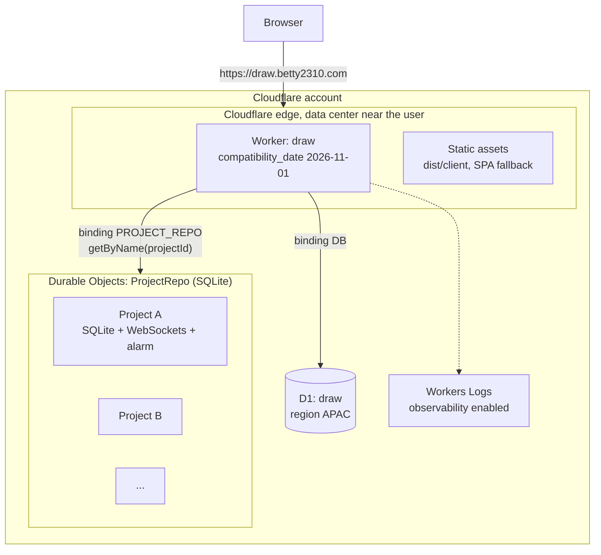
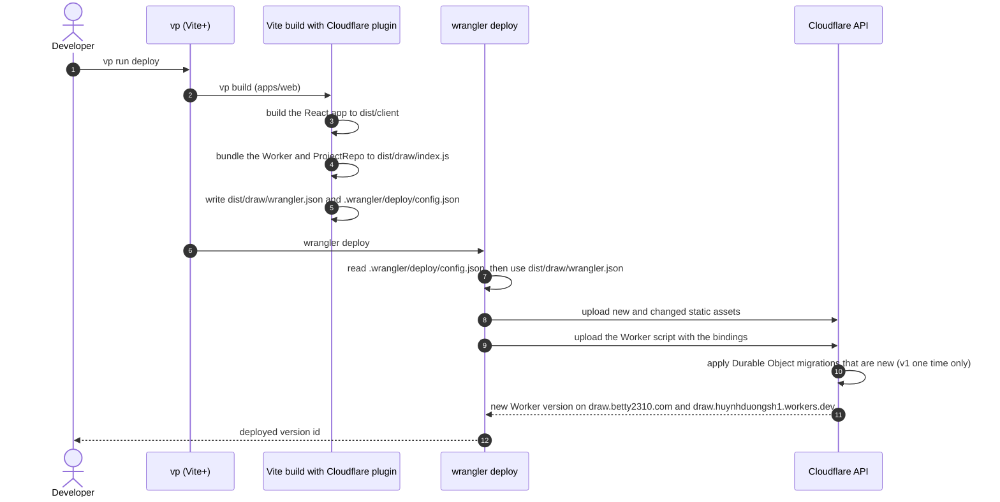

# Deploy infrastructure on Cloudflare

The app runs on the Cloudflare Workers Free plan. All resources are in one Cloudflare account. This document is based on `apps/web/wrangler.jsonc`, the package scripts, and the deployed app at https://draw.betty2310.com. The code design is in [architecture.md](architecture.md).

## Resources

| Resource | Name | Type | Content |
| --- | --- | --- | --- |
| Worker | `draw` | Worker with static assets | The React app (`dist/client`) and the API (`/api/*`) |
| Durable Object namespace | `ProjectRepo` | SQLite-backed Durable Object class | One object for each project: versions, branches, images, the WebSockets, the cleanup alarm |
| D1 database | `draw` (`bf53a9d6-eac4-46db-abba-d8b5a0ba1098`) | D1, region APAC | The `projects` table: the project list |
| URL | `draw.betty2310.com` | Workers Custom Domain in the zone `betty2310.com` | The public URL of the app. It was added in the dashboard, not in `wrangler.jsonc`. |
| URL | `draw.huynhduongsh1.workers.dev` | `workers.dev` subdomain | The first URL of the Worker. It still works. |

There is no R2 bucket, KV namespace, queue or cron trigger. Images are in the SQLite storage of the Durable Object of their project.



## Wrangler configuration

`apps/web/wrangler.jsonc`:

| Key | Value | Effect |
| --- | --- | --- |
| `name` | `draw` | The Worker name, and the `draw.<subdomain>.workers.dev` URL. |
| `main` | `./worker/index.ts` | The Worker entry. It exports the handler and the `ProjectRepo` class from `@draw/server`. |
| `compatibility_date` | `2026-11-01` | The Workers runtime behavior. |
| `observability.enabled` | `true` | Workers Logs keeps the logs of each request. |
| `assets.not_found_handling` | `single-page-application` | An unknown path, for example `/p/<id>`, returns `index.html`. |
| `assets.run_worker_first` | `["/api/*"]` | Only `/api/*` runs the Worker code. All other paths are static files, with no Worker CPU time. |
| `durable_objects.bindings` | `PROJECT_REPO` → `ProjectRepo` | The binding that the Worker uses to get the object of a project. |
| `migrations` | `v1`: `new_sqlite_classes: ["ProjectRepo"]` | Creates `ProjectRepo` as a class with SQLite storage. The Free plan supports only SQLite-backed Durable Objects. |
| `d1_databases` | `DB` → `draw` | The binding of the project list database. |

The `assets.directory` is not in the file. The Cloudflare Vite plugin adds it at build time.

### Bindings

The Worker code reads the bindings from `env` (`Env` in `packages/server/src/index.ts`):

```ts
export interface Env {
  PROJECT_REPO: DurableObjectNamespace<ProjectRepo>;
  DB: D1Database;
  GOOGLE_CLIENT_ID: string;
  GOOGLE_CLIENT_SECRET: string;
}
```

| Binding | Type | Used by |
| --- | --- | --- |
| `PROJECT_REPO` | Durable Object namespace | The WebSocket route (`stub.fetch`) and the routes of versions, branches and images (RPC methods on the stub) |
| `DB` | D1 database | The routes of the project list, the accounts and `/api/health` |
| `GOOGLE_CLIENT_ID` | Variable in `wrangler.jsonc` | The Google OAuth client. It is not secret. |
| `GOOGLE_CLIENT_SECRET` | Secret | The secret of the Google OAuth client |
| `ASSETS` | Static assets | Added by Wrangler. The code does not use it directly. |

### Secrets and variables

The Worker has one variable and one secret, for "Sign in with Google".

| Name | Where | Value |
| --- | --- | --- |
| `GOOGLE_CLIENT_ID` | `vars` in `wrangler.jsonc` | The client ID of the OAuth client `draw web` in the Google Cloud project `draw` |
| `GOOGLE_CLIENT_SECRET` | `npx wrangler secret put GOOGLE_CLIENT_SECRET` in `apps/web`, or the dashboard: Worker `draw` > Settings > Variables and Secrets, type Secret | The client secret. Google shows it only when you make the client. |

The Worker builds the redirect URI from the address of the request, so each address needs its own redirect URI in the OAuth client. The app is published (In production) with a verified brand, so the client `draw web` in the Google Cloud project `draw` has only `https://draw.betty2310.com/api/auth/google/callback`. Google sign-in does not work on `draw.huynhduongsh1.workers.dev`.

For local dev, make an OAuth client in a separate Google Cloud project (for example `draw-dev`) with the redirect URI `http://localhost:5173/api/auth/google/callback`, and put its `GOOGLE_CLIENT_ID` and `GOOGLE_CLIENT_SECRET` in `apps/web/.dev.vars`. Google's policy keeps `localhost` out of the production client. Open the local app on `localhost`, not `127.0.0.1`, or Google refuses the redirect.

The deploy needs two values in the shell or in CI. They are not stored in the Worker:

| Variable | Use |
| --- | --- |
| `CLOUDFLARE_API_TOKEN` | A Cloudflare API token that can edit Workers scripts, Durable Objects and D1 in the account. |
| `CLOUDFLARE_ACCOUNT_ID` | The account that owns the Worker and the D1 database. |

Do not put these values in the repository. `.gitignore` excludes `.env*` and `.dev.vars*`.

## Regions and location

- **D1 is in APAC.** Without a location hint, Cloudflare puts a new database near the computer that creates it. In Phase 0 that was western North America. The database `draw` runs in APAC, near the users in Vietnam. `wrangler d1 info draw` shows `running_in_region: APAC`.
- **A Durable Object is created near the first request to it**, and it stays there. A project is near Vietnam only if a person in Vietnam opens it first. A project created from a computer in the United States stays in the United States.
- **The Worker runs in the data center that gets the request**, for example SIN for a user in Vietnam. `GET /api/health` returns the data center code in `colo`.

## Deploy

The repository uses Vite+ (`vp`). Install it, then install the packages:

```sh
curl -fsSL https://vite.plus | bash
vp install
```

Deploy from the repository root:

```sh
export CLOUDFLARE_API_TOKEN=...   # do not commit
export CLOUDFLARE_ACCOUNT_ID=...
vp run deploy
```

`vp run deploy` runs the root script `vp run @draw/web#deploy`, which runs `vp build && wrangler deploy` in `apps/web`:



The build output:

| Path | Content |
| --- | --- |
| `apps/web/dist/client/` | `index.html`, the JavaScript and CSS in `assets/`, `fonts/`, `libraries/`, icons and `mascot.webp` |
| `apps/web/dist/draw/index.js` | The Worker bundle, with the `ProjectRepo` class |
| `apps/web/dist/draw/wrangler.json` | The Wrangler configuration with the assets directory |
| `apps/web/.wrangler/deploy/config.json` | Points `wrangler deploy` to `dist/draw/wrangler.json` |

A deploy replaces the Worker code. Open WebSockets close when the code changes. The browser connects again and compares the scene hash with the server, so no change is lost (see [sequences.md](sequences.md#offline-then-reconnect)).

### Before a deploy

Run the same checks as the root `ready` script:

```sh
vp check   # format, lint, type check
vp test    # unit tests and the Worker tests in workerd
```

### After a deploy

```sh
curl https://draw.betty2310.com/api/health
# {"ok":true,"colo":"SIN"}
```

For live logs, run `./node_modules/.bin/wrangler tail draw` in `apps/web`, or open Workers Logs in the Cloudflare dashboard.

## Set up a new account

These steps make the same infrastructure in a different Cloudflare account.

1. Create the D1 database in APAC (or the region of the users):

   ```sh
   cd apps/web
   ./node_modules/.bin/wrangler d1 create draw --location apac
   ```

2. Put the new `database_id` in `apps/web/wrangler.jsonc`.
3. Run `vp run deploy`. The first deploy creates the Worker and applies the `v1` migration, which creates the `ProjectRepo` class.

No schema step is necessary. The Worker creates the D1 `projects` table at the first request of each Worker instance, and each Durable Object creates its own tables in its constructor.

## Change the infrastructure

| Change | What to do |
| --- | --- |
| A new Durable Object class | Add a binding and a new migration tag (for example `v2` with `new_sqlite_classes`). Do not change `v1`. |
| Rename or delete `ProjectRepo` | Add a migration with `renamed_classes` or `deleted_classes`. A delete removes the data of all projects. |
| A new column in D1 | Add an `ALTER TABLE` step. `CREATE TABLE IF NOT EXISTS` does not change an existing table. |
| A new column in the Durable Object | Add the step in the `ProjectRepo` constructor. Each object runs it when it starts. |
| A custom domain | Add `routes` with `custom_domain: true` in `wrangler.jsonc`, or add it in the dashboard. |
| A custom domain and Google sign-in | Add `https://<domain>/api/auth/google/callback` to the redirect URIs of the Google OAuth client. |

## Local development

`vp -C apps/web dev` runs the app, the Worker, the Durable Object and a local D1 database in workerd through the Cloudflare Vite plugin. The local data is in `apps/web/.wrangler/state`. It does not use the Cloudflare account and needs no token.

## Free plan limits that apply

| Limit | Free plan | Effect on the app |
| --- | --- | --- |
| Worker requests | 100,000 each day | Each HTTP request to `/api/*` counts. Static files do not run the Worker. 20 incoming WebSocket messages count as 1 request. |
| CPU time | 10 ms for each request | A save of 1 MB uses at most 4 ms (measured in Phase 0, see [plan.md](plan.md#phase-0-results)). |
| Durable Object storage | 5 GB for the account | 30 days of versions for 5 persons who draw 4 hours each day is about 194 MB. |
| SQLite row size | 2 MB | A compressed scene and an image each have a limit of 1.5 MB. |
| WebSocket message | 32 MiB received | Smaller than the scene limit. |
| D1 storage | 5 GB | The project list was 106 kB on 2026-11-15. |

With the Hibernation WebSocket API, an idle editor stays connected but the object does not count duration. The `ping` keepalive is answered by the runtime (`setWebSocketAutoResponse`) and does not wake the object.
