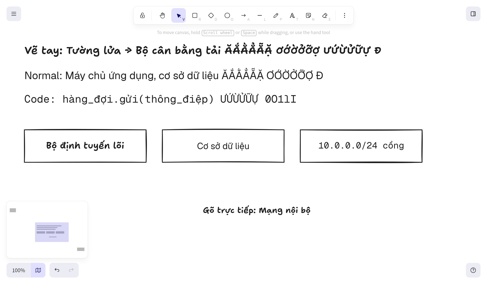

# Diagram app plan

Version 1 is an Excalidraw editor with a project list, autosave, a version history with named versions, and branches, on the Cloudflare free plan. The plan has three phases. The code of Phase 0 and Phase 1 is in the repository.

The repository name and the version rules are in "Decisions".

## Your answers and their effect on the plan

| Your answer | Effect on the plan |
| --- | --- |
| One person edits a branch | The first person who opens a branch edits it. Other persons see the branch as read-only, and they see each save. |
| Shantell Sans, Geist and Geist Mono | "Hand-drawn" uses Shantell Sans. "Normal" uses Geist. "Code" uses Geist Mono. The app ships the three font files. |
| No serif font | Excalidraw has no serif text style, and the plan adds none. |
| No login, one workspace | All persons with the URL see all projects. Each person types a name one time, and the name is the author of each version. |
| Autosave makes the history, and a name makes a commit | Each project has a list of autosave versions. You can give a name to a version, and you can create a branch from a version. |
| No merge | Version 1 has no merge of branches. |
| Latest Excalidraw, for the minimap | The plan pins the build `0.18.0-3a317b5`. |
| Monorepo with Vite+ | pnpm workspace, `vite-plus` 1.6.0, one root `vite.config.ts` for lint, format and tasks. |

## Cloudflare supports WebSocket for live sync

Yes. A Durable Object can be a WebSocket server, and the free plan includes it. The plan uses one Durable Object for each project, so all persons who open a project connect to the same object.

The Cloudflare documentation gives these facts.

- With the Hibernation WebSocket API, clients stay connected while the Durable Object is idle and not in memory. Cloudflare does not count duration during that time.
- 20 incoming WebSocket messages count as 1 request against the limit of 100,000 requests each day.
- A received message has a maximum size of 32 MiB.

tldraw uses the same design in production. Its [Cloudflare template](https://github.com/tldraw/tldraw-sync-cloudflare) has one Durable Object with WebSocket for each room, and its README reports about 50 persons at the same time in one room.

The design must handle two conditions.

- A connection can close, for example at a forced code update. The app connects again and compares the scene hash with the server.
- The memory of the Durable Object is reset after hibernation. The app keeps the edit lock in the WebSocket attachment, which stays through hibernation.

Phase 1 already uses the WebSocket for saves and for save notices. Editing of the same branch by two persons at the same time, with cursors, stays in the later work. It needs a relay of element changes in the Durable Object and the `reconcileElements` function that Excalidraw exports.

## The minimap is only in the `next` build of Excalidraw

The stable release 0.18.1 has no minimap. The minimap was added to `master` on 2026-11-12 in [pull request 12605](https://github.com/excalidraw/excalidraw/pull/12605). The npm tag `next` has it, as build `0.18.0-3a317b5` of 2026-11-14.

The plan pins that exact build. The build is not a release, and its API is different from the 0.18.1 documentation. For example, the `excalidrawAPI` prop is now `onExcalidrawAPI`, and `exportToSvg` is now `exportScene`. An upgrade will be a manual step with a test.

## Fonts: Shantell Sans, Geist and Geist Mono

The `next` build exports the `Fonts` class. The app replaces three entries in the font registry before the editor starts, and it loads the three files before the editor measures text.

| Excalidraw text style | Font file | Size | Vietnamese letters | License |
| --- | --- | --- | --- | --- |
| Hand-drawn (`Excalifont`) | Shantell Sans Informal Regular | 153 KB | 146 of 146 | OFL 1.1 |
| Normal (`Nunito`) | `Geist-Regular.woff2` from npm `geist@1.9.2` | 45 KB | 146 of 146 | OFL 1.1 |
| Code (`Comic Shanns`) | `GeistMono-Regular.woff2` from npm `geist@1.9.2` | 50 KB | 146 of 146 | OFL 1.1 |

I tested the three fonts with the `next` build, React 19 and headless Chromium. The image shows the result. The line at the bottom was typed in the editor, and the minimap is at the lower left.



The test gave these results.

- For each of the 6 text elements, the stored width is equal to the width measured with the new font. For example, the hand-drawn line is 880 px, the Geist line is 736 px, and the Geist Mono line is 671 px.
- Geist is active and not the OS font. A test string is 319 px wide with Geist and 352.3 px wide with the sans-serif default of the test machine.
- SVG export embeds a subset of each of the three fonts.
- The console shows no error, and the minimap shows.

Text has the same size on each computer, because the app ships the fonts. The earlier problem with OS default fonts does not apply.

The method has limits.

- `Fonts.register` is marked private in the TypeScript types. The app must use a type cast.
- The project file keeps the Excalidraw font numbers. A file that you export and open on excalidraw.com shows Excalifont, Nunito and Comic Shanns.
- I did not check the font picker list. I expect that it shows the Excalidraw font names.

## Architecture

One Cloudflare Worker serves the React app as static files and the API. The Worker and each Durable Object run the same code package.

- Each project has one Durable Object with SQLite storage. The Durable Object holds the versions and the branches of the project, and it is the source of truth.
- One D1 database holds the project list, so the list page reads one table.
- The editor has one WebSocket to the Durable Object of the open project. Saves and save notices use the WebSocket. All other calls use HTTP.

## Repository layout

```text
draw/
├─ vite.config.ts            Vite+ root config: lint, fmt, test, run tasks
├─ pnpm-workspace.yaml
├─ apps/
│  └─ web/                   The deployed unit
│     ├─ src/                React app: project list, editor, history panel
│     ├─ public/fonts/       Shantell Sans, Geist, Geist Mono (OFL)
│     ├─ public/libraries/   The 13 default .excalidrawlib files
│     ├─ worker/index.ts     Worker entry, exports from @draw/server
│     ├─ vite.config.ts      React plugin and Cloudflare plugin
│     └─ wrangler.jsonc      Durable Object and D1 bindings
└─ packages/
   ├─ server/                API routes, ProjectRepo Durable Object, SQL
   └─ shared/                API types, scene gzip and hash, version rules
```

The repository is the public GitHub repository `betty2310/draw`. The package scope is `@draw`.

The commands are the Vite+ commands.

| Task | Command |
| --- | --- |
| Local app with Worker and Durable Object | `vp -C apps/web dev` |
| Format, lint, type check | `vp check` |
| Tests | `vp test` |
| Build | `vp -C apps/web build` |
| Deploy | `vp run deploy`, which runs the build and `wrangler deploy` |

## Data model: versions and branches

The model follows your proposal. Autosave makes the history, a name on a version is the commit message, and a branch starts from a version. The model has no separate commit table and no working copy table.

Each project Durable Object has three tables.

| Table | Columns | Content |
| --- | --- | --- |
| `versions` | `id`, `branch`, `scene` (gzip bytes), `hash`, `name` (empty for a version with no name), `author`, `created_at`, `updated_at` | The autosave versions of all branches |
| `branches` | `name` (key), `from_version_id`, `created_at` | One row for each branch |
| `images` | `file_id` (key), `mime`, `bytes` | Pasted images, shared by all versions |

The D1 database has one table, `projects`, with `id`, `name`, `thumb`, `created_at`, `updated_at` and `deleted_at`.

The newest version of a branch is the current state of the branch. The rules are as follows.

- Autosave sends the scene 2 seconds after the last change. The server writes the scene into the open version of the branch. If the branch has no open version, the server adds a new version.
- A version is open for 5 minutes after its creation. It closes earlier when you give it a name, when a branch is created from it, or when a different person starts to edit.
- You can give a name to each version at each time, and you can change or remove the name.
- "Restore" adds a new version to the same branch, with a copy of the old scene. No version is removed.
- "Create branch" adds one `branches` row and one first version in the new branch, with a copy of the scene. Each branch has its own versions, so a switch of branch loses no change.
- Each save has the hash that the browser last saw. The server refuses a save with an old hash, so one person cannot silently replace the work of a different person.
- The server deletes versions with no name that are older than 30 days. It keeps the newest version of each branch and each version that a branch was created from.
- Delete of a project sets `deleted_at`. The project goes to a trash list, and you can restore it.

The 5 minutes and the 30 days are the default. See decision 2.

The storage stays small. Continuous drawing makes 12 versions each hour. With about 27 KB for the compressed scene of a 200 KB drawing, that is 324 KB each hour. In the worst case of 5 persons who draw for 4 hours each day, the versions of 30 days use about 194 MB of the 5 GB limit.

Size limits apply to version 1. A compressed scene has a maximum of 1.5 MB, and each image has a maximum of 1.5 MB. The limits keep each row below the 2 MB row limit.

## Phases

### Phase 0. Project skeleton and measurements

- [x] Create the monorepo with `vp create vite:monorepo` and the three packages.
- [x] Run `vp dev` with the Cloudflare plugin. The page, one API route and one Durable Object with SQLite and WebSocket must work on the local machine.
- [x] Make `vp check` and `vp test` pass, with one test of the Durable Object.
- [x] Deploy to your Cloudflare account with `wrangler deploy`.
- [x] Measure the save time from Vietnam for payloads of 50 KB, 300 KB and 1 MB. Measure the Worker CPU time for the same payloads.

Phase 0 is done when the deployed page saves a test payload through the WebSocket, and the measured numbers are in this plan.

#### Phase 0 results

The app is deployed at https://draw.huynhduongsh1.workers.dev. The page had a "Run save test" button until Phase 1 replaced it with the editor. The test creates a new project, saves random bytes of 50 KB, 300 KB and 1 MB through the WebSocket, 10 times for each size, and shows the time from send to the server reply. The server replies with the SHA-256 of the stored bytes, and the page checks it.

Random bytes do not compress, so each size is the size on the network, the same as a gzip scene of that size.

These facts are different from the plan or are new.

- Vite+ with the Cloudflare plugin works. `vp -C apps/web dev` runs the page, the API and the Durable Object, and `vp run deploy` builds and deploys. The fallback in "Risks" is not necessary.
- Vite+ 1.6.0 includes Vitest 5. `@cloudflare/vitest-pool-workers` needs Vitest 4, so it does not work. The Durable Object test starts the real Worker in workerd with `unstable_startWorker` from Wrangler, and it connects with a WebSocket.
- The D1 database `draw` is in the APAC region. Without a location hint, Cloudflare put it in western North America, near the computer that created it.
- Cloudflare creates a Durable Object near the first request to it. The project of a person in Vietnam is thus near Vietnam only if that person opens it first. The save test creates a new project on each run for this reason.
- The Cloudflare API token can deploy a Worker with a Durable Object and create a D1 database.

CPU time on Cloudflare, from `wrangler tail`, 10 saves for each size. The object ran in LAX, and the client was in the western United States.

| Payload | CPU time of one save | Wall time of one save in the object | Save time from the western United States (median) |
| --- | --- | --- | --- |
| 50 KB | 0 to 1 ms | 44 to 45 ms | 106 ms |
| 300 KB | 1 ms | 49 to 52 ms | 124 ms |
| 1 MB | 1 to 4 ms, median 2 ms | 55 to 60 ms | 166 ms |

The first save of each size took longer: 337 ms, 87 ms and 91 ms of wall time in the object. The Worker used 3 ms of CPU time for `/api/health` and 3 ms for the WebSocket upgrade.

The results are as follows.

- A save of 1 MB uses at most 4 ms of CPU time. That is below the 10 ms limit of the Workers Free plan, which is the strictest limit that can apply to a Durable Object. The CPU limit is not a risk for saves.
- Each save waits about 45 to 60 ms in the object, with almost no CPU time. The cause is probably the wait for the confirmation of the SQLite write before the reply. This time does not change with the distance to the browser.

Save time from Vietnam, measured by the owner on 2026-11-14 with Chrome on macOS. The Worker and the Durable Object ran in SIN (Singapore). Each size has 10 saves.

| Payload | Median | 90th percentile | Max |
| --- | --- | --- | --- |
| 50 KB | 87 ms | 170 ms | 188 ms |
| 300 KB | 107 ms | 171 ms | 267 ms |
| 1 MB | 179 ms | 219 ms | 259 ms |

The WebSocket connected in 567 ms. The first save of 1 KB, which also created the Durable Object, took 72 ms.

The results are as follows.

- A save of 1 MB from Vietnam takes less than 0.3 s. Autosave sends the scene 2 seconds after the last change, so a second browser can show the change in about 2.3 s. That is within the 3 seconds of the Phase 1 check.
- About 45 to 60 ms of each save is the wait in the object. The rest is the network from Vietnam to Singapore and the upload of the bytes.

### Phase 1. Editor, projects and autosave

- [x] Editor page with the pinned Excalidraw build, the minimap on, and the three fonts.
- [x] The 13 default libraries, loaded when the editor opens for the first time.
- [x] Project list page: create, rename, move to trash, restore, with a thumbnail for each project.
- [x] Name prompt at the first visit. The browser stores the name.
- [x] Autosave: to IndexedDB immediately, and to the server 2 seconds after the last change. A status text shows "Saved", "Saving" or "Offline, saved in this browser".
- [x] The `versions` table with the 5 minute rule. Phase 1 writes the versions, and Phase 2 shows them.
- [x] One editor for each branch. A second person gets a read-only view that updates after each save, and a "Take over" button.
- [x] Pasted images, stored in the `images` table.
- [x] Import and export of `.excalidraw` files.

Phase 1 is done when these checks pass on the deployed app.

- You draw, close the tab during a change, and open the project again. No change is lost.
- A second browser shows your change no more than 3 seconds after you stop drawing.
- You draw without a network connection, and the app sends the changes when the connection is back.

#### Phase 1 results

The three checks passed on the deployed app on 2026-11-14, with two headless Chromium browsers in the orb (Worker in SEA). Each check read the local copy of the editor and the copy of the second browser, which is the server scene.

| Check | Result |
| --- | --- |
| Close the tab during a change | The tab closed 12 ms after a new shape, before the server save. The server did not have the shape 4 s later. After the project opened again, the shape was there and the server had it. A second test closed the tab during a drag, with the mouse button down. The moved shapes were also kept and saved. |
| Second browser in 3 seconds | 5 runs: 2,060 to 2,092 ms from the mouse release to the change in the second browser. |
| Draw offline | The status showed "Offline, saved in this browser", and the server did not have the 2 new shapes. The second browser showed them 224 ms after the network was back. |

These facts are different from the plan or are new.

- A save is one binary WebSocket message: a JSON header with the hash that the browser last saw, and the gzip scene. The server sends a scene to the browser in the same form. A browser that connects tells the hash that it has, and the server sends the scene only if it is different.
- When the server refuses a save with an old hash, the browser merges its changes into the server scene with `reconcileElements` and saves again. Test: the first browser drew offline, the second browser took over and drew, then the first browser took over again. The server had the shapes of both browsers.
- A browser that loses the edit lock while it has unsaved changes keeps them in IndexedDB. It merges them when it edits again.
- The edit lock belongs to one page load. A page that connects again, for example after a network change, keeps the lock. A different tab of the same person is a second browser.
- Deleted elements stay in the saved scene, so a merge does not bring them back.
- Shantell Sans comes from release 1.011 of `arrowtype/shantell-sans`, not from the tldraw package. The OFL license files are next to the fonts.
- The Worker creates the D1 `projects` table at the first request of each Worker instance, so a new database needs no manual step.
- The project list gets a new thumbnail at most each 10 seconds while you draw, with the save time.
- The tests start the real Worker and Durable Object in workerd. They cover the open version, the refused save with an old hash, the edit lock with "Take over", a page that connects again, the project API, and the images. A unit test covers the 5 minute rule.

### Phase 2. Version history, named versions and branches

- [ ] History panel in the Excalidraw sidebar. It lists the versions of the current branch with the newest first, and each row shows the name, the author and the time. A filter shows the named versions only.
- [ ] Read-only preview of a version on the canvas.
- [ ] "Name this version" on each row. `Ctrl+S` gives a name to the current version.
- [ ] "Restore this version".
- [ ] "Create branch from this version".
- [ ] Branch selector: switch, rename, delete. `main` cannot be deleted.
- [ ] Delete of old versions with no name, at most one time each day for each project.

Phase 2 is done when tests of the Durable Object cover the version rules, restore, branch and the delete of old versions, and screenshots show each flow in the deployed app.

### Later, not planned in detail

Compare of two versions on the canvas, merge, live editing of one branch by two persons with cursors, a GitHub backup of the named versions, and login with Cloudflare Access.

## Dependencies

Tell me if you do not want one of these packages.

| Package | Use |
| --- | --- |
| `@excalidraw/excalidraw@0.18.0-3a317b5`, `react`, `react-dom` 19 | Editor |
| `vite-plus` 1.6.0 (MIT) | Toolchain |
| `@cloudflare/vite-plugin` 1.69.1, `wrangler` 4 | Local Worker runtime and deploy |
| `hono` | API routes with shared types between the Worker and the app |
| `idb-keyval` | IndexedDB storage for the local copy |
| `geist` 1.9.2 (OFL), Shantell Sans from `arrowtype/shantell-sans` (OFL) | Font files, copied to `public/fonts` |

The plan has no UI component library and no router library. The app has two pages.

## Decisions

1. The name is `draw`. The repository is the public GitHub repository `betty2310/draw`. The owner gave this answer.
2. A new version starts after each 5 minutes of drawing, and versions with no name are deleted after 30 days. This is the default of the plan. The owner did not confirm it, and the owner can change the two numbers. The two numbers are in `packages/shared/src/version-rules.ts`.

## Risks

- All persons who have the URL can read, change and delete all projects, because there is no login. The trash list makes a delete reversible. Cloudflare Access can be added later with no code change.
- A version with no name is deleted after 30 days. Give a name to each version that you want to keep.
- The pinned Excalidraw build is not a release. A later build can change the `Fonts` class or the minimap. The signal is a type error or mixed fonts after an upgrade.
- Vite+ with the Cloudflare plugin works in Phase 0 for dev, build and deploy. If a later version breaks it, the fallback is `wrangler dev` for the Worker and a Vite proxy for `/api`.
- A save of 1 MB uses at most 4 ms of the 10 ms CPU limit, and it takes less than 0.3 s from Vietnam. See "Phase 0 results".

## Out of scope

Version 1 does not include a mobile layout, a public share link, merge, live editing of one branch by two persons, a serif font, or an import from tldraw files.

## Sources

- Research: [Diagram app research](https://ampcode.com/artifacts/diagram-app-research-d96a26c7-bd9d-4741-b81d-b68a2bc2759c)
- Excalidraw `next` build: `npm pack @excalidraw/excalidraw@next`, [changelog](https://github.com/excalidraw/excalidraw/blob/master/packages/excalidraw/CHANGELOG.md)
- Geist: `npm pack geist@1.9.2`, [vercel/geist-font license](https://github.com/vercel/geist-font/blob/main/LICENSE.txt)
- WebSocket: [Durable Objects WebSockets](https://developers.cloudflare.com/durable-objects/best-practices/websockets/), [Durable Objects limits](https://developers.cloudflare.com/durable-objects/platform/limits/), [tldraw sync](https://tldraw.dev/docs/sync)
- Vite+: [guide](https://viteplus.dev/guide), [monorepo](https://viteplus.dev/guide/monorepo), [1.0 announcement](https://voidzero.dev/posts/announcing-vite-plus-1-0)
- Cloudflare plugin: [get started](https://developers.cloudflare.com/workers/vite-plugin/get-started/)
- Test files: `.amp/in/orb-backup/font-spike-next/` in the thread workspace
