# Sequence diagrams

These diagrams show the main flows of the app, as the code on `main` does them. The components and the message names are described in [architecture.md](architecture.md).

The participants:

| Name | Code |
| --- | --- |
| Editor | `apps/web/src/Editor.tsx` with Excalidraw |
| Sync | `ProjectSync` in `apps/web/src/sync.ts` |
| IDB | IndexedDB in the browser (idb-keyval) |
| Worker | The Hono app in `packages/server/src/index.ts` |
| DO | The `ProjectRepo` Durable Object of the project, `packages/server/src/project-repo.ts` |
| D1 | The D1 database with the `projects` table |

## Contents

- [Open the project list](#open-the-project-list)
- [Open a project](#open-a-project)
- [Autosave](#autosave)
- [Close the tab during a change](#close-the-tab-during-a-change)
- [Offline then reconnect](#offline-then-reconnect)
- [Save with an old hash (conflict)](#save-with-an-old-hash-conflict)
- [Second browser and Take over](#second-browser-and-take-over)
- [Paste an image](#paste-an-image)
- [Name a version (Ctrl+S)](#name-a-version-ctrls)
- [Preview a version](#preview-a-version)
- [Restore a version](#restore-a-version)
- [Create a branch](#create-a-branch)
- [Rename a branch](#rename-a-branch)
- [Delete a branch](#delete-a-branch)
- [Delete of old versions (alarm)](#delete-of-old-versions-alarm)

## Open the project list

The project list reads only D1. It does not wake a Durable Object.

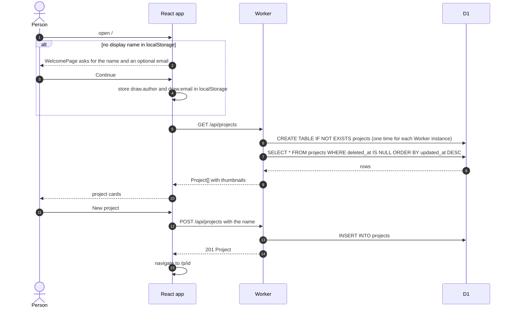

## Open a project

The editor shows the local copy first, then the server tells the role and sends the scene if it is different.

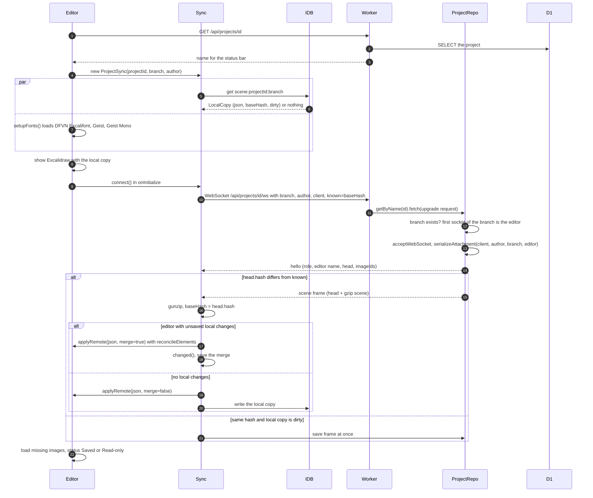

## Autosave

Each change goes to IndexedDB at once and to the server 2 seconds after the last change. The 5 minute rule decides if the save writes into the open version or adds a version.

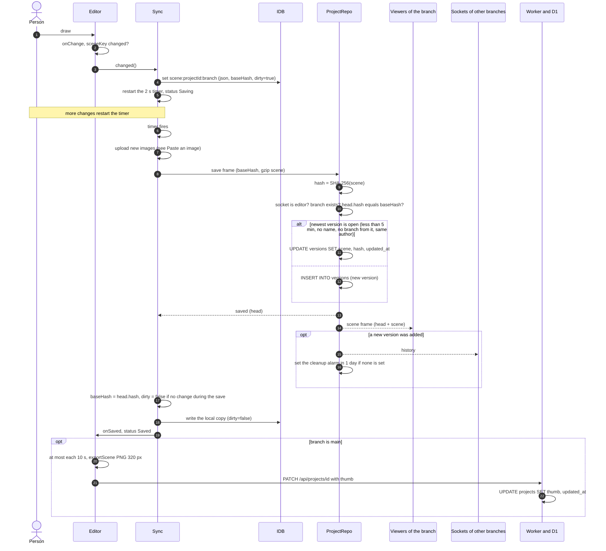

The thumbnail goes to D1, not to the Durable Object. The new `updated_at` moves the project to the top of the list.

## Close the tab during a change

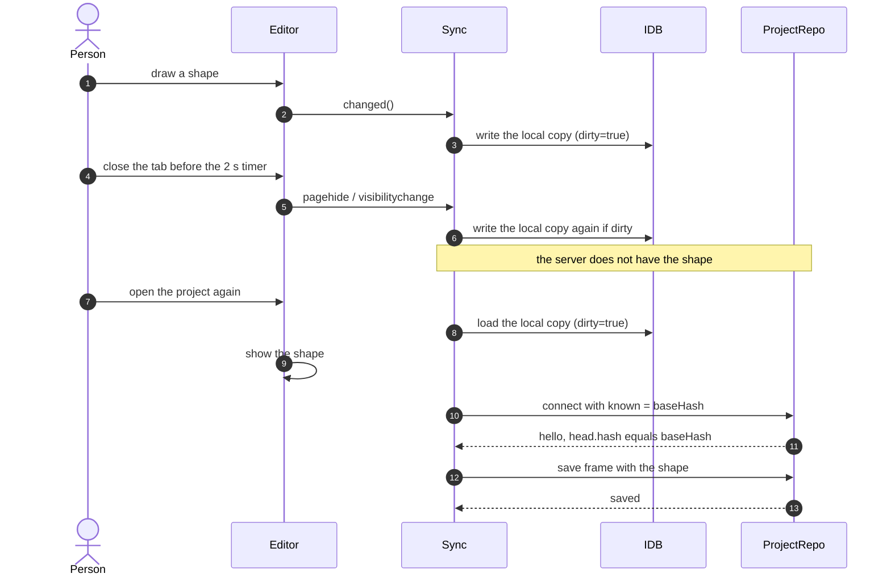

## Offline then reconnect

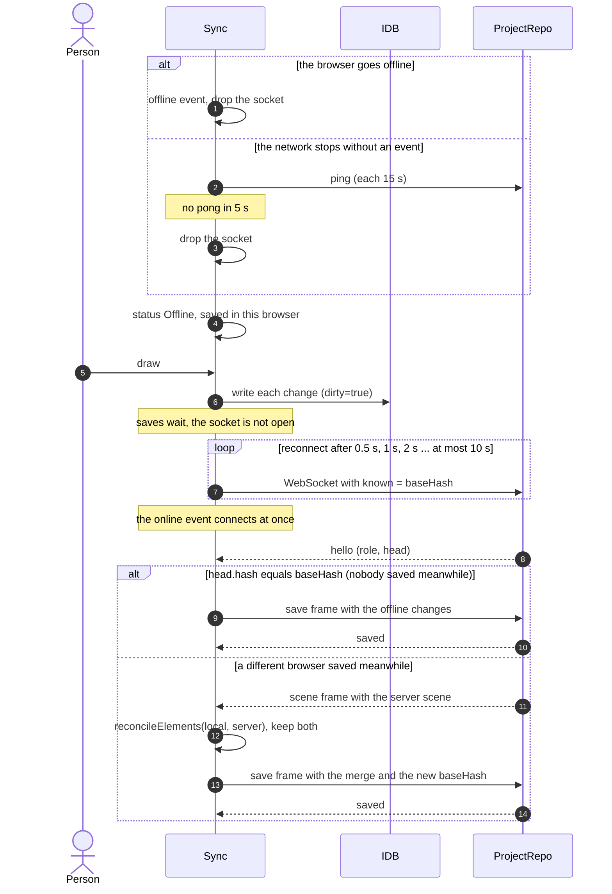

The same flow runs after a deploy, which closes all WebSockets. A page that connects again has the same `client` id, so it keeps its edit lock.

## Save with an old hash (conflict)

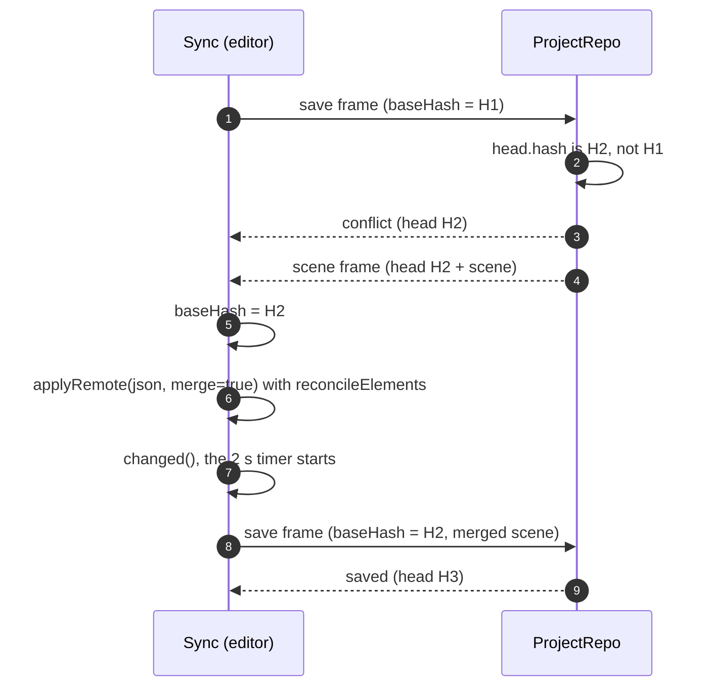

## Second browser and Take over

One person edits a branch. The edit lock is in the WebSocket attachment, so it stays through hibernation.

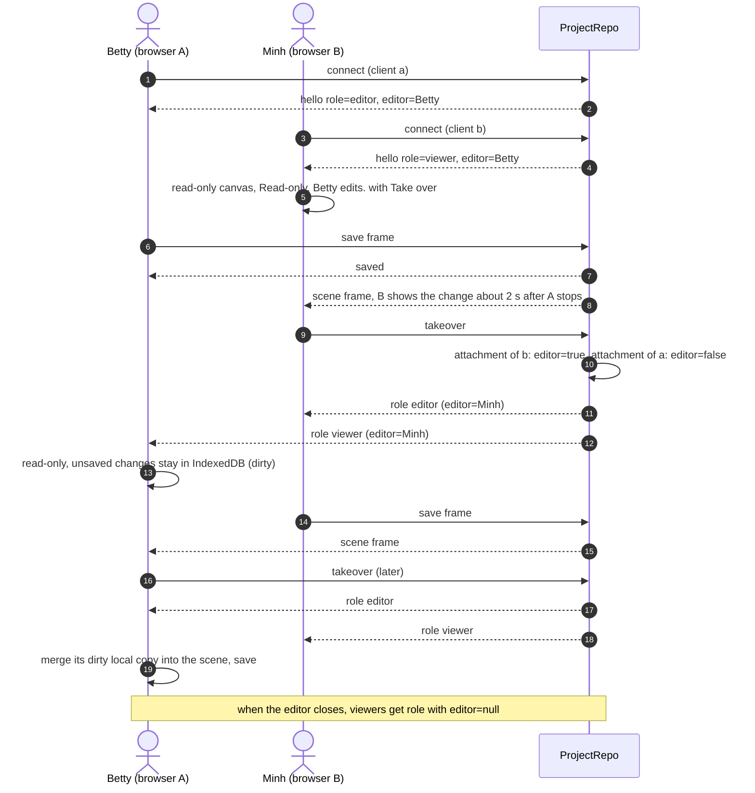

## Paste an image

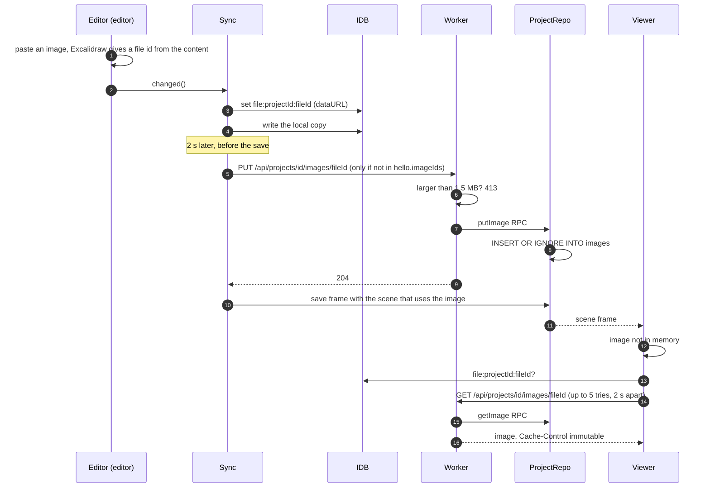

## Name a version (Ctrl+S)

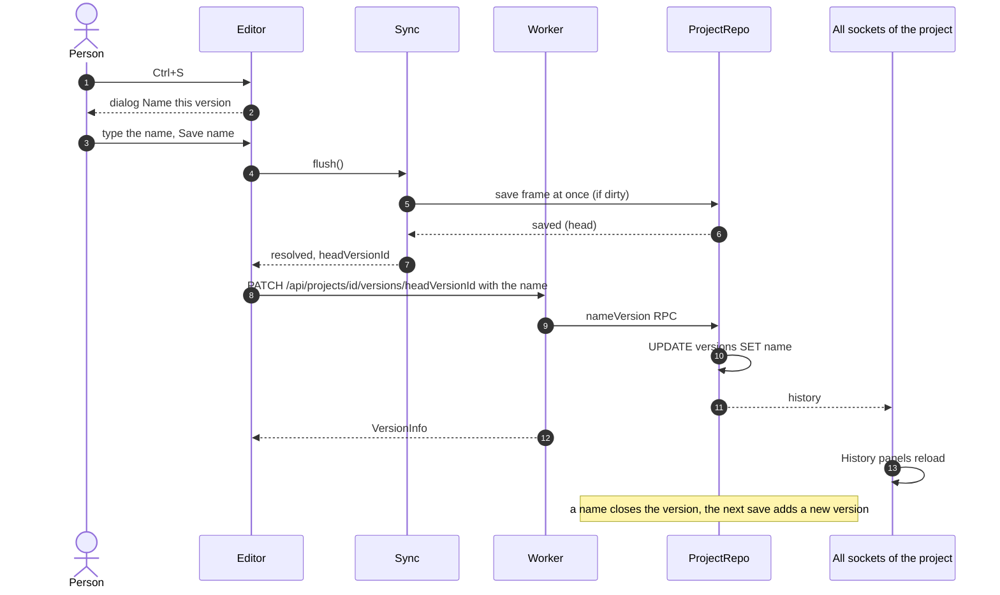

## Preview a version

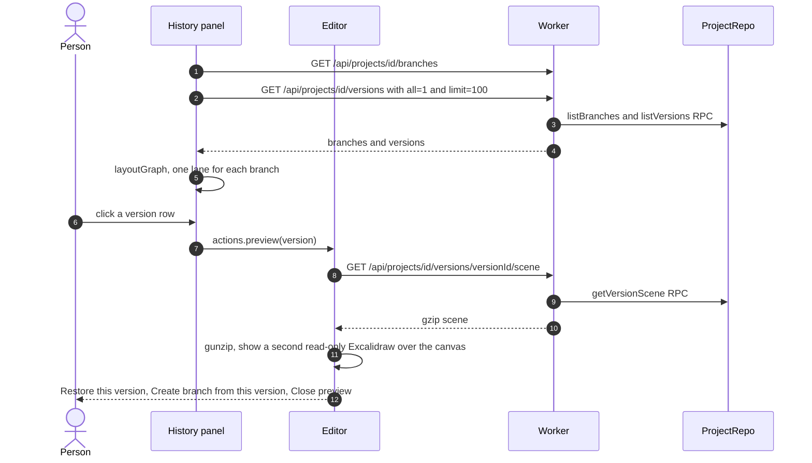

## Restore a version

Restore adds a new version with a copy of the old scene. No version is removed.

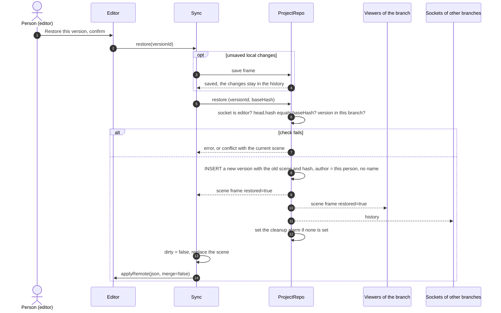

## Create a branch

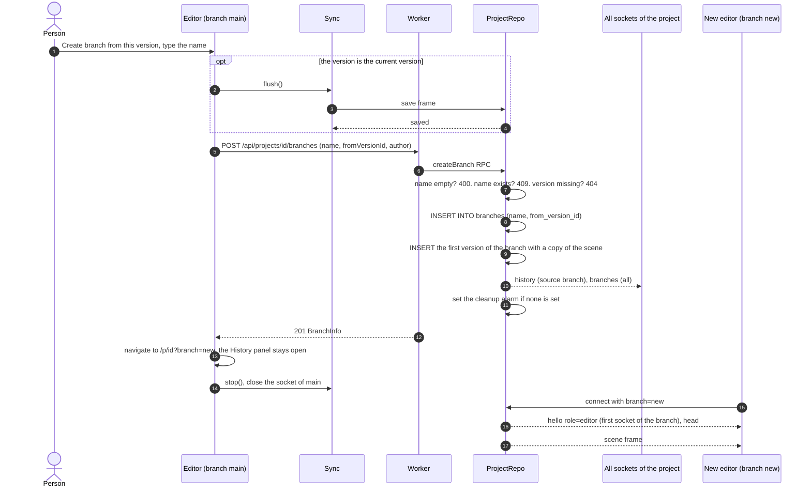

## Rename a branch

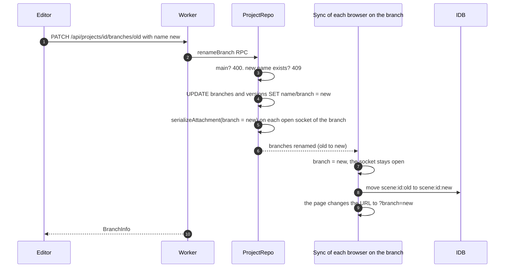

## Delete a branch

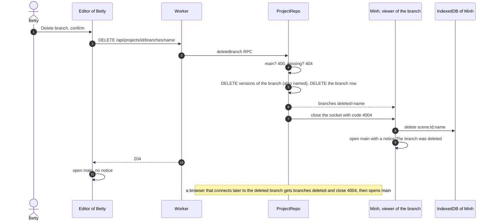

## Delete of old versions (alarm)

The first new version sets an alarm for one day later. The alarm deletes versions with no name that were last saved more than 30 days ago, and keeps the newest version of each branch and each version that a branch starts from.

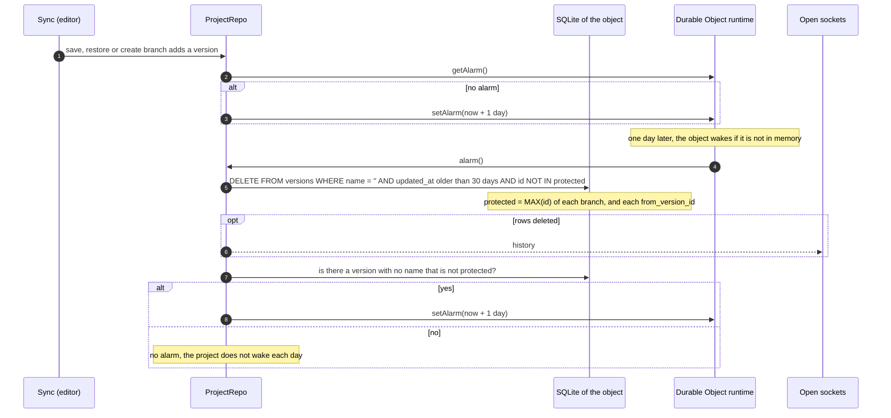
